# Atlas parlamentario de Bolivia: 1982–2026

Fecha de investigación: 11 de octubre de 2026.

## Resultado y alcance

Base de 11 períodos parlamentarios, 45 referencias anuales, distribución departamental y esquemas de escaños de ambas cámaras. La unidad principal es el período surgido de una elección. Los archivos anuales apuntan a esa unidad para evitar duplicar datos y para admitir cambios documentados en el futuro.

La distribución por organización es la **asignación electoral de origen**. No equivale a una reconstrucción de la adscripción efectiva de todos los años. Este criterio permite comparar elecciones sin convertir escisiones, suplencias o pactos posteriores en resultados electorales.

Los períodos se expresan por años de ejercicio, con precisión anual y extremos compartidos. El Congreso restituido en 1982 procede de la elección de 1980. Las elecciones de 2005, 2009 y 2014 originaron períodos iniciados en 2006, 2010 y 2015, respectivamente. 2030 es un final previsto; la cobertura de esta entrega termina en 2026.

## Composición por período

En las columnas siguientes, el número que acompaña a cada sigla es su cantidad de escaños.

| Ejercicio | Elección | Diputados | Senadores | Fuente |
|---|---:|---|---|---|
| 1982–1985 | 1980 | UDP 47; MNR 34; ADN 24; PS-1 10; FDR 5; FSB 3; PRA 3; MNRU 2; MITKA 1; MITKA-1 1 | UDP 10; MNR 10; ADN 6; PS-1 1 | [Fuente oficial](https://web.oep.org.bo/wp-content/uploads/2017/03/Atlas_Electoral_tomo-I_Cap_I-II.pdf) |
| 1985–1989 | 1985 | MNR 43; ADN 41; MIR 15; MNRI 8; MNRV 6; PS-1 5; FPU 4; FSB 3; PDC 3; MRTKL 2 | MNR 16; ADN 10; MIR 1 | [Fuente oficial](https://web.oep.org.bo/wp-content/uploads/2017/03/Atlas_Electoral_tomo-I_Cap_I-II.pdf) |
| 1989–1993 | 1989 | MNR 40; ADN 38; MIR 33; IU 10; CONDEPA 9 | MNR 9; ADN 8; MIR 8; CONDEPA 2 | [Fuente oficial](https://web.oep.org.bo/wp-content/uploads/2017/03/Atlas_Electoral_tomo-I_Cap_I-II.pdf) |
| 1993–1997 | 1993 | MNR-MRTKL 52; AP 35; UCS 20; CONDEPA 13; MBL 7; ARBOL 1; ASD 1; EJE 1 | MNR-MRTKL 17; AP 8; UCS 1; CONDEPA 1 | [Fuente oficial](https://web.oep.org.bo/wp-content/uploads/2017/03/Atlas_Electoral_tomo-I_Cap_I-II.pdf) |
| 1997–2002 | 1997 | ADN-NFR-PDC 32; MNR-MRTKL 26; MIR-NM 23; UCS 21; CONDEPA-MP 19; MBL 5; IU 4 | ADN-NFR-PDC 11; MNR-MRTKL 4; MIR-NM 7; UCS 2; CONDEPA-MP 3 | [Fuente oficial](https://web.oep.org.bo/wp-content/uploads/2017/04/Atlas_Electoral_tomo-I_Cap_III-1.pdf) |
| 2002–2006 | 2002 | MNR-MBL 36; MAS 27; MIR-NM-FRI 26; NFR 25; MIP 6; UCS-FSB 5; ADN 4; PS 1 | MNR-MBL 11; MAS 8; MIR-NM-FRI 5; NFR 2; ADN 1 | [Fuente oficial](https://web.oep.org.bo/wp-content/uploads/2017/04/Atlas_Electoral_tomo-I_Cap_III-1.pdf) |
| 2006–2010 | 2005 | MAS 72; PODEMOS 43; UN 8; MNR 7 | MAS 12; PODEMOS 13; UN 1; MNR 1 | [Fuente oficial](https://web.oep.org.bo/wp-content/uploads/2017/04/Atlas_Electoral_tomo-I_Cap_III-2.pdf) |
| 2010–2015 | 2009 | MAS-IPSP 88; PPB-CN 37; UN-CP 3; AS 2 | MAS-IPSP 26; PPB-CN 10 | [Fuente oficial](https://web.oep.org.bo/wp-content/uploads/2017/03/Atlas_Electoral_tomo-I_Cap_IV.pdf) |
| 2015–2020 | 2014 | MAS-IPSP 88; UD 32; PDC 10 | MAS-IPSP 25; UD 9; PDC 2 | [Fuente oficial](https://web.oep.org.bo/wp-content/uploads/2017/04/Atlas_Electoral_Tomo_IV.pdf) |
| 2020–2025 | 2020 | MAS-IPSP 75; CC 39; CREEMOS 16 | MAS-IPSP 21; CC 11; CREEMOS 4 | [Fuente oficial](https://fuentedirecta.oep.org.bo/noticia/tse-entrega-credenciales-a-autoridades-electas-en-comicios-generales/) |
| 2025–2030 | 2025 | PDC 49; LIBRE 39; UNIDAD 26; AP 8; APB-SÚMATE 5; MAS-IPSP 2; BIA-YUQUI 1 | PDC 16; LIBRE 12; UNIDAD 7; APB-SÚMATE 1 | [Fuente oficial](https://web.oep.org.bo/wp-content/uploads/2025/08/30-08-2025-Separata-resultados-EG2025.pdf) |

Las alianzas mantienen la denominación que aparece en las tablas. **AP de 1993 (Acuerdo Patriótico) y AP de 2025 (Alianza Popular) son organizaciones distintas**; sus identificadores incluyen el año electoral. El mismo criterio se aplica a otras siglas y alianzas. No se asigna toda una coalición a uno de sus integrantes.

## Cambios del sistema electoral

| Elección | Diputados por tipo | Senado | Regla y norma principal |
|---|---|---|---|
| 1980 | 0 U / 130 P / 0 E | 27 | Constitución de 1967; Ley Electoral 531, de 8 de abril de 1980. Cociente simple y residuos mayores en listas departamentales. [Referencia](https://web.oep.org.bo/wp-content/uploads/2017/03/Atlas_Electoral_tomo-I_Cap_I-II.pdf) |
| 1985 | 0 U / 130 P / 0 E | 27 | Constitución de 1967; Ley 531 (1980); convocatoria adelantada mediante Ley 679, de 14 de diciembre de 1984. Cociente simple y residuos mayores. [Referencia](https://web.oep.org.bo/wp-content/uploads/2017/03/Atlas_Electoral_tomo-I_Cap_I-II.pdf) |
| 1989 | 0 U / 130 P / 0 E | 27 | Constitución de 1967; Ley Electoral 857, de 20 de mayo de 1986. Doble cociente departamental. [Referencia](https://web.oep.org.bo/wp-content/uploads/2017/03/Atlas_Electoral_tomo-I_Cap_I-II.pdf) |
| 1993 | 0 U / 130 P / 0 E | 27 | Constitución de 1967; Ley Electoral 1246, de 5 de julio de 1991. Divisores impares (Sainte-Laguë: 1, 3, 5…). [Referencia](https://web.oep.org.bo/wp-content/uploads/2017/03/Atlas_Electoral_tomo-I_Cap_I-II.pdf) |
| 1997 | 68 U / 62 P / 0 E | 27 | Constitución reformada en 1994–1995; Ley 1246; Ley 1704, de 2 de agosto de 1996. Sistema mixto: mayoría relativa uninominal y divisores naturales con compensación de las victorias uninominales. [Referencia](https://web.oep.org.bo/wp-content/uploads/2017/04/Atlas_Electoral_tomo-I_Cap_III-1.pdf) |
| 2002 | 68 U / 62 P / 0 E | 27 | Constitución reformada; Código Electoral de 1999 (Ley 1984). Sistema mixto con divisores naturales y compensación de las victorias uninominales. [Referencia](https://web.oep.org.bo/wp-content/uploads/2017/04/Atlas_Electoral_tomo-I_Cap_III-1.pdf) |
| 2005 | 70 U / 60 P / 0 E | 27 | Constitución reformada; Código Electoral; Decreto Supremo 28429, de 1 de noviembre de 2005. Sistema mixto con divisores naturales y compensación de las victorias uninominales. [Referencia](https://web.oep.org.bo/wp-content/uploads/2017/04/Atlas_Electoral_tomo-I_Cap_III-2.pdf) |
| 2009 | 70 U / 53 P / 7 E | 36 | Constitución de 2009; Ley 4021 del Régimen Electoral Transitorio, de 14 de abril de 2009. Sistema mixto: 70 uninominales, 53 plurinominales y 7 especiales; proporcionalidad compensatoria. [Referencia](https://web.oep.org.bo/wp-content/uploads/2017/03/Atlas_Electoral_tomo-I_Cap_IV.pdf) |
| 2014 | 63 U / 60 P / 7 E | 36 | Constitución de 2009; leyes 018 y 026 (2010); Ley 421, de 7 de octubre de 2013. 63 uninominales, 60 plurinominales y 7 especiales; proporcionalidad compensatoria. [Referencia](https://web.oep.org.bo/wp-content/uploads/2017/04/Atlas_Electoral_Tomo_IV.pdf) |
| 2020 | 63 U / 60 P / 7 E | 36 | Constitución de 2009; leyes 018 y 026; Ley 421; Ley 1266 de régimen excepcional y normas de convocatoria 2020. 63 uninominales, 60 plurinominales y 7 especiales; proporcionalidad compensatoria. [Referencia](https://web.oep.org.bo/wp-content/uploads/2020/10/Compendio_EG_2020.pdf) |
| 2025 | 63 U / 60 P / 7 E | 36 | Constitución de 2009; leyes 018, 026 y 1096; Ley 1614, de 15 de enero de 2025. 63 uninominales, 60 plurinominales y 7 especiales; proporcionalidad compensatoria. [Referencia](https://apisi.senado.gob.bo/images/9ef926b3-c1ea-4783-9a84-8bae10d65ee9_1747929333.pdf) |

U: uninominales. P: representación por listas departamentales; incluye el régimen anterior a 1997. E: especiales indígena originario campesinas. En todos los períodos incluidos hay 130 escaños de Diputados. Hasta la elección de 2005 hay 27 senadores, tres por departamento: dos para la primera mayoría y uno para la segunda. Desde la elección de 2009 hay 36, cuatro por departamento, con asignación proporcional por divisores naturales.

En el sistema mixto, las diputaciones de lista compensan las victorias uninominales conforme a las reglas de cada elección; no deben sumarse como dos repartos proporcionales independientes. La normativa incluida es la que explica cada elección, no un inventario exhaustivo de todas las leyes vigentes durante el mandato.

## Distribución territorial de Diputados

Orden departamental: Chuquisaca, La Paz, Cochabamba, Oruro, Potosí, Tarija, Santa Cruz, Beni y Pando.

| Elecciones | CH | LP | CB | OR | PT | TJ | SC | BE | PA |
|---|---:|---:|---:|---:|---:|---:|---:|---:|---:|
| [1980, 1985, 1989 y 1993](https://web.oep.org.bo/wp-content/uploads/2017/03/Atlas_Electoral_tomo-I_Cap_I-II.pdf) | 13 | 28 | 18 | 10 | 19 | 9 | 17 | 9 | 7 |
| [1997 y 2002](https://web.oep.org.bo/wp-content/uploads/2017/04/Atlas_Electoral_tomo-I_Cap_III-1.pdf) | 11 | 31 | 18 | 10 | 15 | 9 | 22 | 9 | 5 |
| [2005](https://web.oep.org.bo/wp-content/uploads/2017/04/Atlas_Electoral_tomo-I_Cap_III-2.pdf) | 11 | 29 | 19 | 9 | 14 | 9 | 25 | 9 | 5 |
| [2009](https://web.oep.org.bo/wp-content/uploads/2017/03/Atlas_Electoral_tomo-I_Cap_IV.pdf) | 11 | 29 | 19 | 9 | 14 | 9 | 25 | 9 | 5 |
| [2014 y 2020](https://web.oep.org.bo/wp-content/uploads/2017/04/Atlas_Electoral_Tomo_IV.pdf) | 10 | 29 | 19 | 9 | 13 | 9 | 28 | 8 | 5 |
| [2025](https://apisi.senado.gob.bo/images/9ef926b3-c1ea-4783-9a84-8bae10d65ee9_1747929333.pdf) | 9 | 29 | 19 | 9 | 13 | 9 | 29 | 8 | 5 |

Los archivos de datos incluyen además el desglose U/P/E. El Senado representa a todos los departamentos con el mismo número de escaños en cada régimen. Esta entrega contiene metadatos territoriales; un mapa geográfico histórico necesita geometrías de las circunscripciones de cada elección. No es correcto reutilizar la cartografía de 2025 para representar 1985.

## Casos que la plantilla debe conservar

- **1982:** restitución del Parlamento de 1980. Su asignación electoral es una referencia, no una auditoría de cambios personales o políticos ocurridos entre la elección y la restitución. [Atlas, páginas PDF 38 y 40](https://web.oep.org.bo/wp-content/uploads/2017/03/Atlas_Electoral_tomo-I_Cap_I-II.pdf).
- **2014:** los cuadros de asignación del Atlas suman 130 escaños; la tabla de candidatos electos señala una candidatura titular masculina de UD sin reemplazo. El dato se guarda como incidencia separada, sin atribuirle una duración no comprobada. [Atlas IV, páginas PDF 22–23](https://web.oep.org.bo/wp-content/uploads/2017/04/Atlas_Electoral_Tomo_IV.pdf).
- **2019–2020:** el artículo 2 de la Ley 1266 dejó sin efecto las elecciones de 2019 y sus resultados. Se conserva el período anterior durante la transición, hasta el nuevo período surgido de las elecciones de 2020. [Compendio 2020, página PDF 305](https://web.oep.org.bo/wp-content/uploads/2020/10/Compendio_EG_2020.pdf); [informe de observación sobre la prórroga](https://web.oep.org.bo/wp-content/uploads/2021/03/Informes_Observadores_EG_2020.pdf).
- **2025–2026:** la referencia es la asignación legislativa de la primera vuelta de 2025. La segunda vuelta presidencial no crea otro reparto de curules. La distribución territorial corresponde a la Ley 1614: Santa Cruz gana un escaño y Chuquisaca pierde uno. [Ley oficial](https://apisi.senado.gob.bo/images/9ef926b3-c1ea-4783-9a84-8bae10d65ee9_1747929333.pdf); [OEP](https://fuentedirecta.oep.org.bo/noticia/con-la-promulgacion-de-la-ley-de-escanos-el-tse-inicia-los-ajustes-en-la-cartografia-electoral/).

## Plantilla anual y uso en el atlas

Cada año contiene: país, fecha de referencia, período principal, períodos que comparten ese año, elección de origen, enlace a la ficha de gestión, tipo de composición y estado de la reconstrucción anual. La ficha de gestión aporta institución, cámaras, organizaciones, reparto territorial, normativa, fuentes e incidencias.

El corte de los años anteriores es el 31 de diciembre; el de 2026 es el 11 de octubre. Los años de cambio conservan ambas gestiones y usan la más reciente iniciada para la referencia de cierre. En 2005, 2009 y 2014, la elección ya realizada no reemplaza al Parlamento que todavía estaba en ejercicio al cierre del año.

Para presentar una composición efectiva de bancadas debe añadirse un `snapshot_efectivo` con su fecha, cantidades por cámara y evidencia parlamentaria. Por ahora es `null`: significa **dato no reconstruido**, no cero cambios. Las fuentes electorales por sí solas no acreditan la adscripción política de cada año.

Archivos principales:

- `datos/atlas_parlamentario.json`: base completa y fuentes.
- `datos/gestiones/`: 11 fichas.
- `datos/anios/`: 45 referencias, una por año de 1982 a 2026.
- `datos/plantilla_anual.json`: estructura reutilizable.
- `datos/bancadas_por_gestion.csv`: distribución electoral por organización.
- `datos/distribucion_departamental.csv`: escaños por departamento y tipo.
- `mapas/`: 11 esquemas comparables de ambas cámaras.
- `fuentes/`: copias intactas de las publicaciones consultadas y registro de descarga.

Los colores de los gráficos son editoriales. Cada punto equivale a un escaño asignado; su ubicación es esquemática y no reproduce el asiento real de una persona ni la posición ideológica de la organización.

## Fichas visuales por período

### 1982–1985 · elección 1980

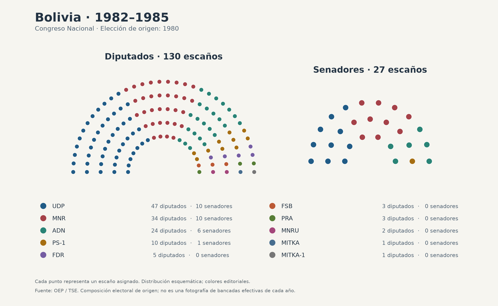

### 1985–1989 · elección 1985

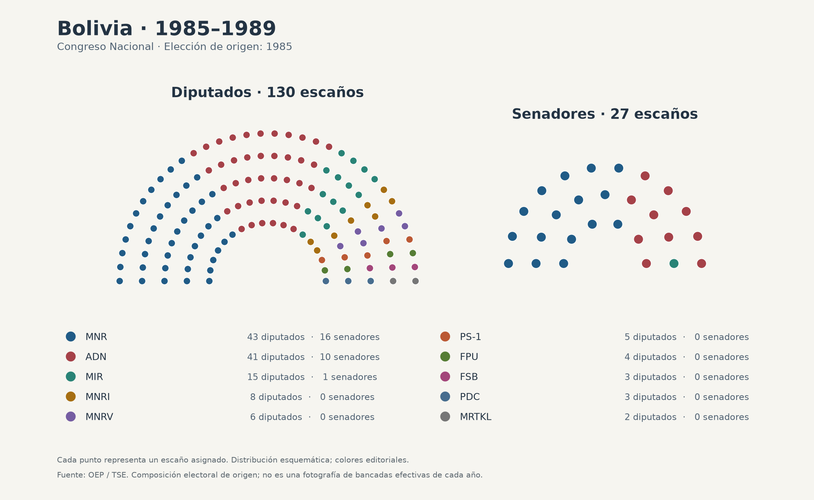

### 1989–1993 · elección 1989

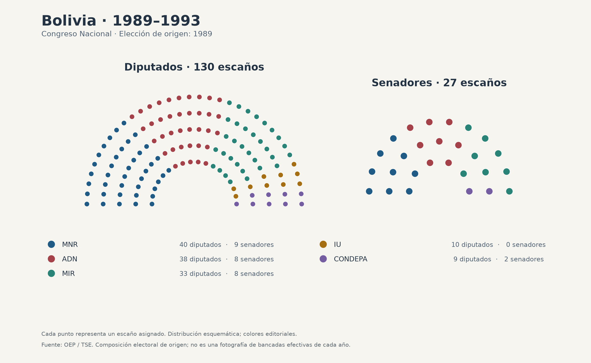

### 1993–1997 · elección 1993

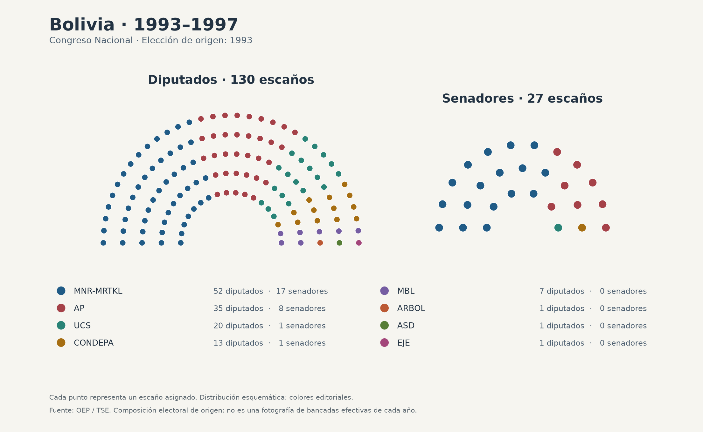

### 1997–2002 · elección 1997

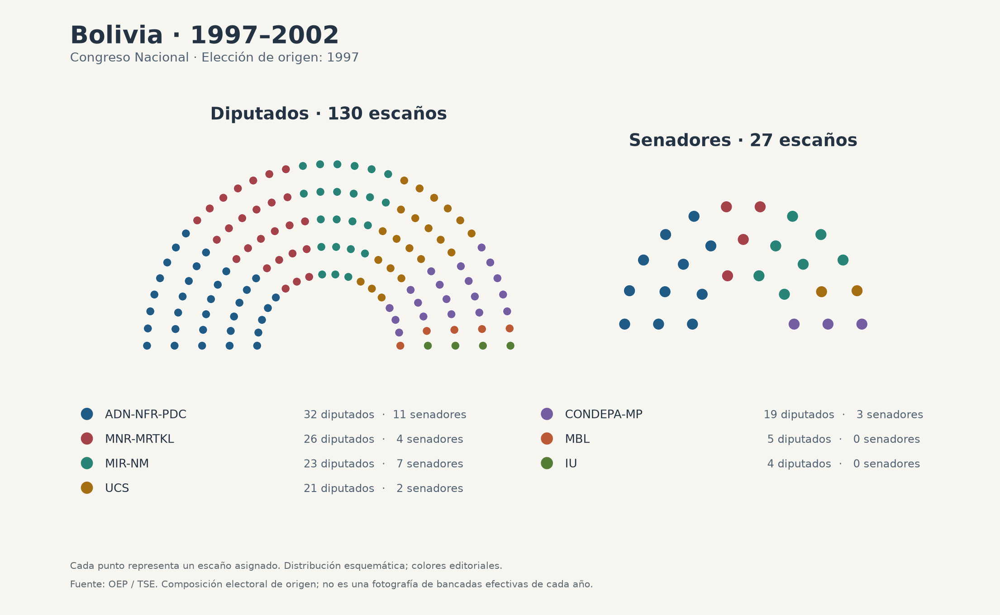

### 2002–2006 · elección 2002

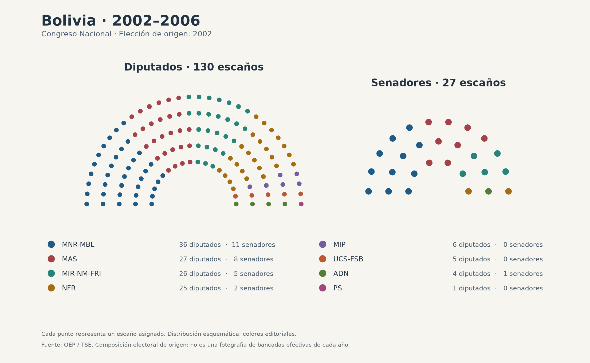

### 2006–2010 · elección 2005

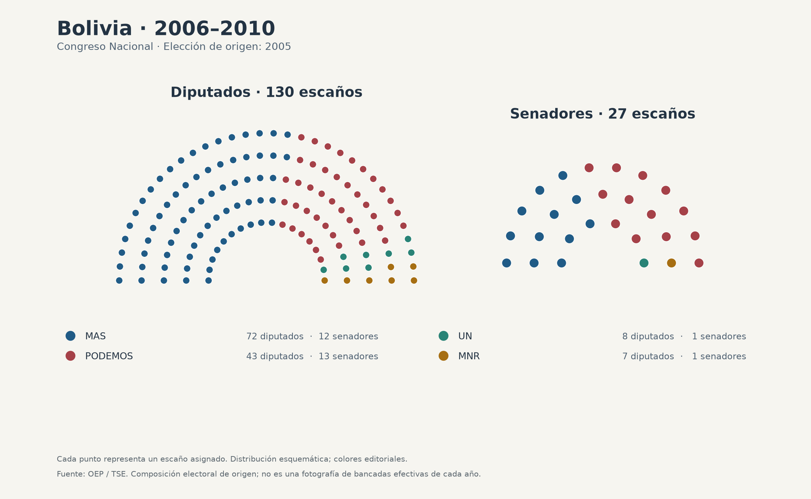

### 2010–2015 · elección 2009

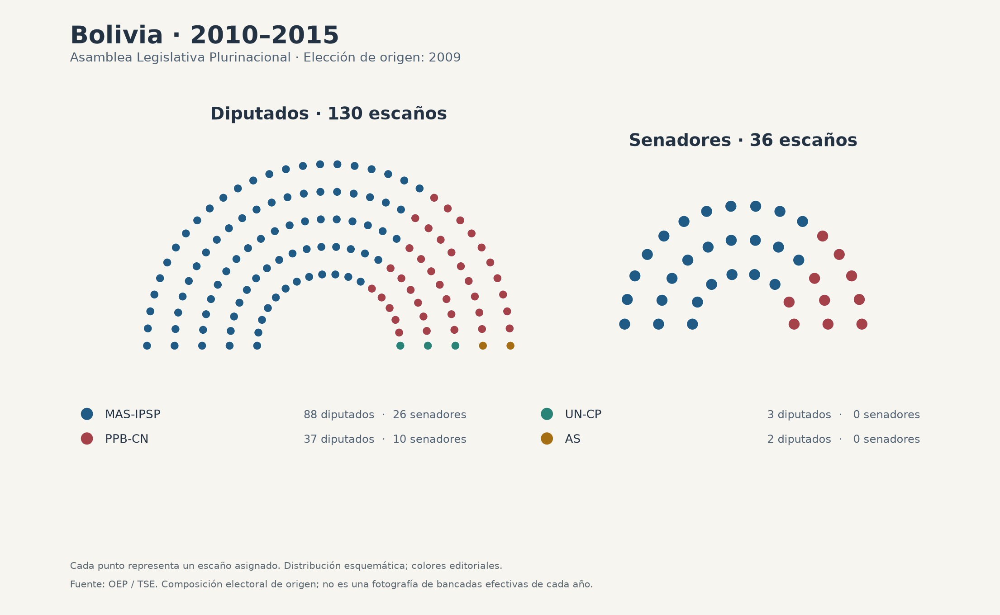

### 2015–2020 · elección 2014

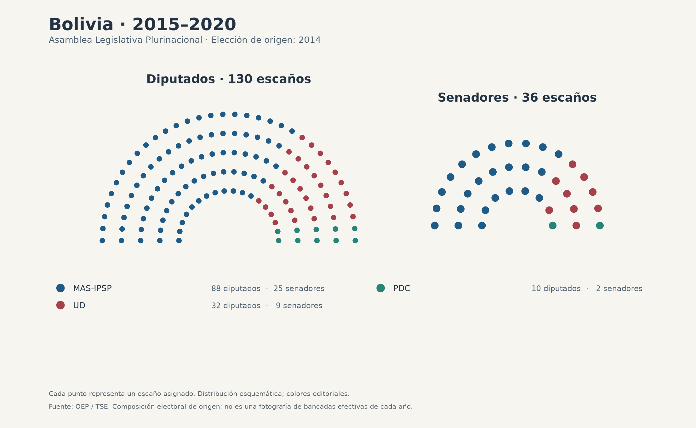

### 2020–2025 · elección 2020

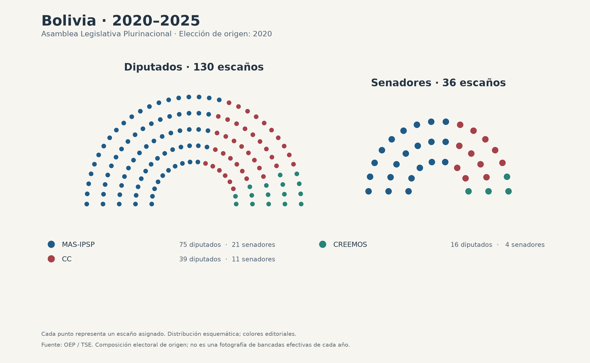

### 2025–2030 · elección 2025

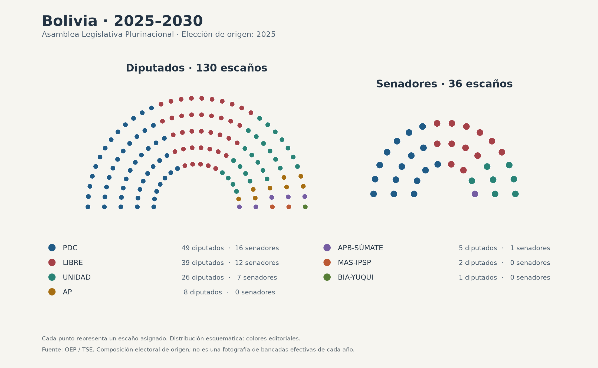

